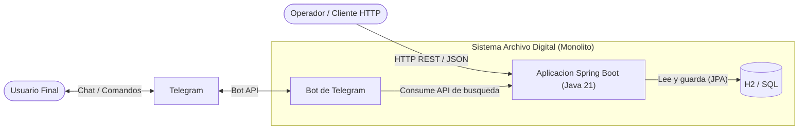
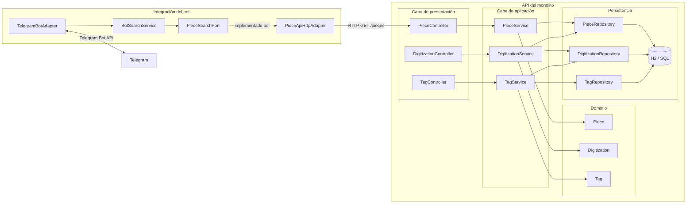

# Arquitectura del sistema · Archivo Digital

Documento correspondiente a la card **DS-23 · Diagrama(s) de arquitectura**, alineado con el enunciado del TP Integrador, las convenciones en [`AGENTS.md`](../AGENTS.md) y el modelo en capas de Fowler visto en clase.

Tablero editable en Figma (FigJam): [DS-23 Arquitectura - Archivo Digital (UNSAM)](https://www.figma.com/board/XlGeJOCSq67QyzZ8mdJdir)

---

## 1. Vista general (Contexto y Contenedores)

La aplicación se resuelve como un **monolito** en Java 21 + Spring Boot con una **única base de datos relacional (H2)**. Las funcionalidades de Digitalización, Catalogación y Disponibilización se exponen como APIs REST (sin pantallas web), y la Visualización se resuelve mediante un **Bot de Telegram** que consume la API de búsqueda.



---

## 2. Arquitectura interna (Capas de Fowler)

Dentro del monolito (`ar.edu.unsam.ddso.tp`), las clases se organizan por capa respetando las responsabilidades vistas en clase:

- **Presentación (`controller`):** recibe pedidos HTTP, valida/deserializa DTOs (`dto`) y delega en los servicios. No contiene lógica de negocio.
- **Aplicación / Orquestación (`service`):** orquesta los casos de uso y límites transaccionales (`@Transactional`), busca entidades en los repositorios, invoca las reglas del dominio y mapea a DTOs de respuesta.
- **Dominio (`model`):** entidades `@Entity` (`Piece`, `Digitization`, `Tag`) con sus atributos, relaciones e invariantes de negocio.
- **Fuente de Datos (`repository`):** interfaces Spring Data JPA (`JpaRepository`) que resuelven la persistencia y consultas sobre la base relacional H2.

### Integración del bot de Telegram

El bot se integra mediante el patrón Adapter para desacoplar la plataforma de mensajería de la lógica de búsqueda y de la API del sistema.

- **Adaptador de entrada (`TelegramBotAdapter`):** recibe las actualizaciones de Telegram y procesa los comandos.
- **Servicio del bot (`BotSearchService`):** coordina la búsqueda y prepara el mensaje de respuesta.
- **Puerto (`PieceSearchPort`):** define la operación de búsqueda que necesita el bot.
- **Adaptador de salida HTTP (`PieceApiHttpAdapter`):** implementa el puerto y consume `PieceController` mediante HTTP (`GET /pieces`). No invoca directamente a `PieceService`.

Esta separación permite reemplazar Telegram por otra plataforma de mensajería sin modificar la lógica de búsqueda del bot ni las capas internas de la API.



### Estructura de paquetes

```text
bot/
├── adapter/
│   ├── http/
│   │   └── PieceApiHttpAdapter.java
│   └── telegram/
│       └── TelegramBotAdapter.java
├── config/
│   └── TelegramBotConfiguration.java
├── exception/
│   └── BotSearchException.java
├── port/
│   └── PieceSearchPort.java
└── service/
    └── BotSearchService.java
```
