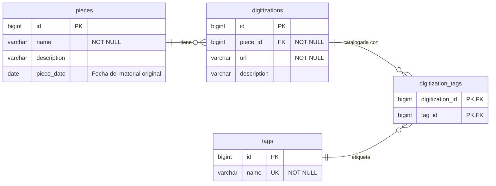

# Diagrama de Base de Datos · Archivo Digital

Documento correspondiente a la card **DS-24 · Diagrama de base de datos**, basado en el modelo de dominio (`docs/modelo-dominio.md`), la entidad [`Piece`](../src/main/java/ar/edu/unsam/ddso/tp/model/Piece.java) y las convenciones de mapeo objeto-relacional vistas en clase (*Datos en el diseño de SW* y `AGENTS.md`).

Tablero editable en Figma (FigJam): [DS-24 Diagrama de Base de Datos - Archivo Digital (UNSAM)](https://www.figma.com/board/gt0GlHWXkxpRR9qTfOkgKs)

---

## Esquema relacional (H2 / SQL)

## Decisiones del esquema

- **Nombres de tablas en `snake_case` plural** (`pieces`, `digitizations`, `tags`, `digitization_tags`), según [`AGENTS.md`](../AGENTS.md).
- **Claves primarias sintéticas (`id`)** autogeneradas (`IDENTITY`), como en la clase de Modelo Relacional y ORM.
- **`pieces.piece_date`:** se evita el nombre `date` porque es palabra reservada en SQL.
- **Relación `1:N` (`pieces` → `digitizations`):** resuelta con la foreign key `digitizations.piece_id` (una digitalización pertenece obligatoriamente a una sola pieza).
- **Relación `N:M` (`digitizations` ↔ `tags`):** resuelta con la tabla intermedia `digitization_tags` con clave primaria compuesta `(digitization_id, tag_id)` y foreign keys hacia ambas tablas.
- **`tags.name` único (`UK`):** evita tags duplicados en el conjunto cerrado administrable en tiempo de ejecución.
