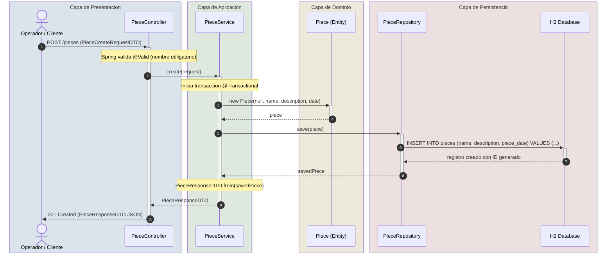
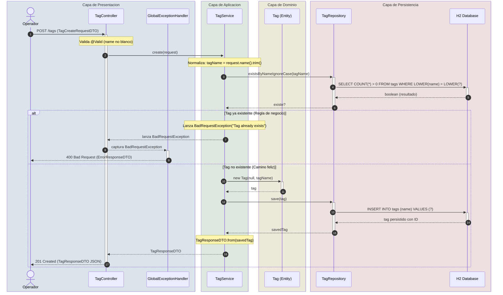
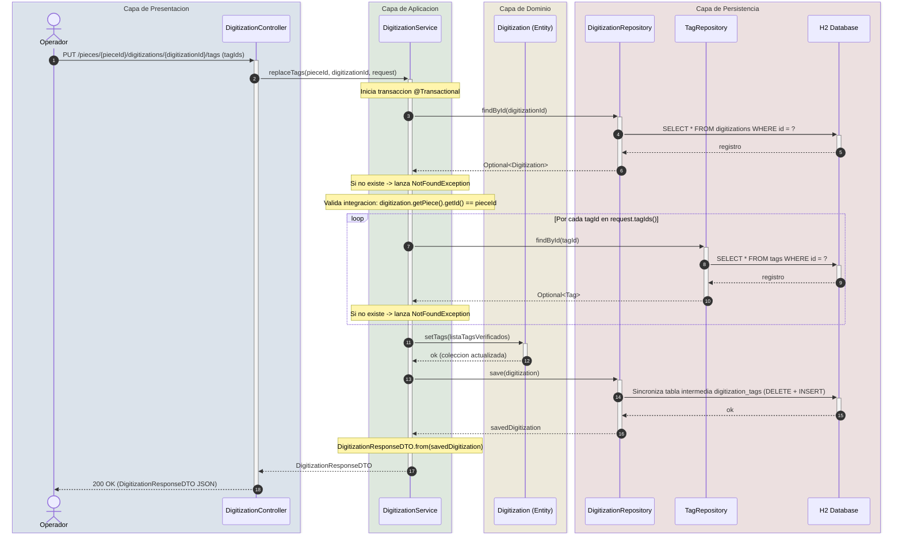
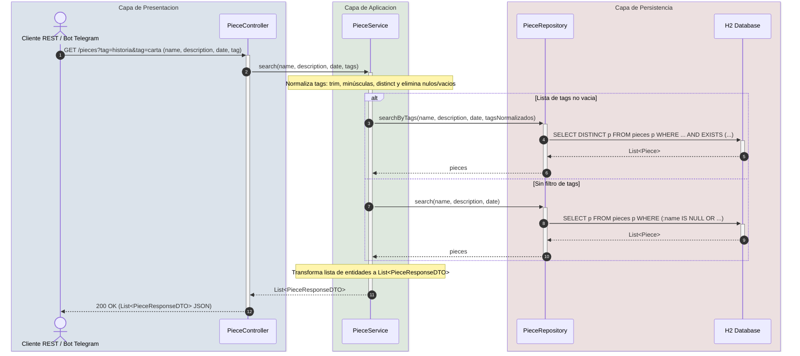

# Diagramas de secuencia con capas de la arquitectura · Archivo Digital

Documento correspondiente a la card **DS-25 · Diagramas de secuencia con capa de cada clase**, perteneciente a la épica **Documentación /docs**.

El objetivo de este documento es representar los flujos más importantes del sistema, explicitando a qué capa del modelo de capas de Martin Fowler pertenece cada clase participante.

---

## 1. Mapeo de clases a las capas de Fowler

Siguiendo el diseño arquitectónico del monolito (`ar.edu.unsam.ddso.tp`), las clases se distribuyen en cuatro capas bien diferenciadas:

| Capa (Fowler) | Paquete / Componentes | Clases participantes en los diagramas | Responsabilidad principal |
|---|---|---|---|
| **Presentación** | `controller`, `dto`, `exception` | `PieceController`, `TagController`, `DigitizationController`, `GlobalExceptionHandler`, Request/Response DTOs | Punto de entrada HTTP REST. Deserializa requests, valida contratos (`@Valid`), delega en el Service y traduce respuestas/excepciones a códigos de estado HTTP. **No contiene reglas de negocio.** |
| **Aplicación (Servicio)** | `service` | `PieceService`, `TagService`, `DigitizationService` | Orquesta los casos de uso del sistema. Maneja las fronteras transaccionales (`@Transactional`), coordina entidades y repositorios, ejecuta validaciones de negocio y mapea entidades a DTOs. |
| **Dominio** | `model` | `Piece`, `Digitization`, `Tag` | Entidades del negocio (`@Entity`). Encapsulan el estado, relaciones (`@ManyToOne`, `@ManyToMany`) e invariantes propias de cada concepto. |
| **Persistencia / Fuente de Datos** | `repository`, Base de datos | `PieceRepository`, `TagRepository`, `DigitizationRepository`, `H2 Database` | Interfaces Spring Data JPA (`JpaRepository`) que abstraen el acceso a datos y traducen operaciones y consultas JPQL a sentencias SQL sobre la base relacional H2. |

---

## 2. Flujo 1: Alta de una Pieza física (`POST /pieces`)

Este flujo representa la creación de un nuevo material físico en el archivo (`DS-11`).

### Paso a paso del flujo:
1. El **Operador** envía un request HTTP `POST /pieces` con el cuerpo JSON correspondiente.
2. `PieceController` (Presentación) valida las anotaciones de validación (`@NotBlank`). Si es válido, invoca a `PieceService.create(...)`.
3. `PieceService` (Aplicación) ejecuta bajo contexto `@Transactional`: instancia la entidad `Piece` con los datos del request.
4. `PieceService` solicita persistir la entidad invocando `PieceRepository.save(piece)`.
5. `PieceRepository` (Persistencia) traduce la entidad a una sentencia `INSERT SQL` en la base H2.
6. H2 genera la clave primaria autoincremental y confirma la persistencia.
7. `PieceService` transforma la entidad persistida a `PieceResponseDTO` mediante el método estático de fábrica `from(...)`.
8. `PieceController` responde con código HTTP `201 Created` y el recurso recién creado en formato JSON.

---

## 3. Flujo 2: Alta de Tag con validación de duplicados (`POST /tags`)

Este flujo documenta la administración en tiempo de ejecución de las etiquetas cerradas (`DS-16`), mostrando tanto el camino exitoso como el tratamiento de excepciones de negocio ante nombres duplicados.

### Decisiones de diseño en este flujo:
- **Validación insensible a mayúsculas:** `existsByNameIgnoreCase` evita tener duplicados semánticos como `"Fotografía"` y `"fotografía"`.
- **Manejo uniforme de errores:** Cuando el servicio lanza `BadRequestException`, la capa de Presentación captura la excepción mediante `@RestControllerAdvice` (`GlobalExceptionHandler`), asegurando que el cliente reciba un código HTTP `400 Bad Request` estructurado.

---

## 4. Flujo 3: Catalogación de una Digitalización con Tags (`PUT .../tags`)

Este flujo documenta la asociación y reemplazo atómico de etiquetas sobre una digitalización existente (`DS-14` y `DS-17`).

### Puntos clave del diseño:
- **Validación atómica de tags:** Cada tag en la lista es verificado en `TagRepository`. Si al menos uno no existe, la transacción se aborta con `NotFoundException`, garantizando consistencia.
- **Validación de pertenencia jerárquica:** Se verifica que la digitalización realmente pertenezca a la pieza indicada en la URL (`pieceId`), evitando inconsistencias lógicas en rutas anidadas.
- **Mapeo relacional en H2:** La relación `@ManyToMany` entre `Digitization` y `Tag` sincroniza automáticamente la tabla de unión `digitization_tags`.

---

## 5. Flujo 4: Búsqueda de Piezas por filtros y etiquetas (`GET /pieces?tag=...`)

Este flujo documenta la disponibilización y búsqueda multicriterio (`DS-19`), consumida tanto por clientes HTTP REST como por el Bot de Telegram.

### Puntos clave del diseño:
- **Lógica de tags normalizada:** La capa de Servicio asegura que las cadenas se limpien y pasen en minúsculas para que la búsqueda sea insensible a mayúsculas/minúsculas.
- **Uso de `EXISTS` en la capa de datos:** El repositorio ejecuta una subconsulta `EXISTS` sobre las digitalizaciones y sus tags vinculados, evitando que una pieza se duplique en el resultado si varias de sus digitalizaciones coinciden con los tags buscados.
- **Desacoplamiento:** El cliente sólo recibe DTOs limpios con la información requerida, sin filtrar detalles internos de la base de datos.
