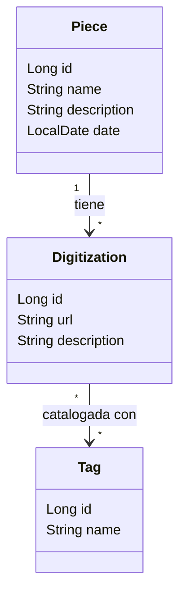

# Modelo de dominio (inicial)

| Entidad | Qué representa |
|---|---|
| `Piece` (pieza) | El material físico del archivo (una foto, una carta, un documento). Es lo que se busca. |
| `Digitization` (digitalización) | Una URL a un recurso digital más una descripción. Pertenece a una sola pieza. |
| `Tag` (etiqueta) | Una palabra de un conjunto cerrado que el administrador puede cambiar en tiempo de ejecución. |

**Relaciones:**
- **Piece 1 → N Digitization.** En la base, la tabla `digitizations` tiene la columna `piece_id`.
- **Digitization N ↔ N Tag.** En la base hay una tabla intermedia, `digitization_tags`.

**Decisiones:**
- **`Tag` es una entidad y no un `enum`:** los tags tienen que poder cambiarse con la app corriendo.
- **Los tags van en la digitalización y no en la pieza:** así lo pide la consigna. La búsqueda por tag devuelve las piezas que tengan al menos una digitalización con ese tag.
- **`Piece.date` es la fecha del material original**, no la de carga. En la base se guarda en la columna `piece_date`, porque `DATE` es palabra reservada de SQL.
