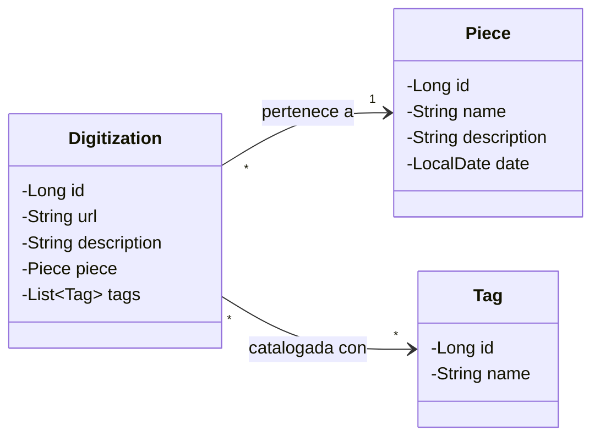

# Modelo de dominio · Diagrama de clases (`DS-22`)

Documento correspondiente a las cards **DS-04** y **DS-22 · Diagrama de clases de dominio**, alineado con las entidades implementadas en `src/main/java/ar/edu/unsam/ddso/tp/model/` y las definiciones de la cátedra.

## Clases y atributos del dominio

| Entidad | Tabla SQL | Qué representa | Campos clave |
|---|---|---|---|
| `Piece` (Pieza) | `pieces` | Material físico del archivo (foto, carta, documento). Es el objeto que devuelven las búsquedas. | `id`, `name` (obligatorio), `description`, `date` (`piece_date`) |
| `Digitization` (Digitalización) | `digitizations` | URL a un recurso digital y una descripción. Pertenece obligatoriamente a una sola `Piece`. | `id`, `url` (obligatorio), `description`, `piece` (`piece_id` FK), `tags` |
| `Tag` (Etiqueta) | `tags` | Palabra clave de un conjunto cerrado administrable en tiempo de ejecución. | `id`, `name` (obligatorio y único) |

## Relaciones y navegabilidad implementada

- **`Digitization * → 1 Piece` (`@ManyToOne`, `LAZY`, obligatoria):**
  - En código, la referencia vive en `Digitization.piece` (`@JoinColumn(name = "piece_id", nullable = false)`).
  - La navegación unidireccional evita serializaciones circulares y mantiene simple el agregado `Piece`. Las digitalizaciones de una pieza se consultan desde `DigitizationRepository.findByPieceId(pieceId)`.
- **`Digitization * → * Tag` (`@ManyToMany`, `LAZY`):**
  - Resuelta con la tabla intermedia `digitization_tags` (`digitization_id`, `tag_id`).
  - `Digitization` es el lado dueño de la asociación (`Digitization.tags`).

## Decisiones de diseño

- **`Tag` es una entidad y no un `enum`:** permite al administrador crear, listar y eliminar tags en tiempo de ejecución sin recompilar.
- **Eliminación segura de tags asociados:** cuando se elimina un `Tag` que ya estaba vinculado a una o más digitalizaciones, primero se desasocia de `Digitization.tags` para evitar errores de integridad referencial en SQL (`digitization_tags`).
- **Los tags se asocian a `Digitization` y no a `Piece`:** así lo pide el enunciado; las búsquedas por tag devuelven las `Piece` que tengan al menos una `Digitization` catalogada con ese tag.
- **Sin entidades `Usuario` / `Administrador` / `Rol`:** confirmado con la cátedra que el dominio no requiere modelar personas ni permisos; el administrador refiere al operador que administra los tags vía API.
- **`Piece.date` es la fecha del material original**, mapeada a la columna `piece_date` porque `DATE` es palabra reservada en SQL.
